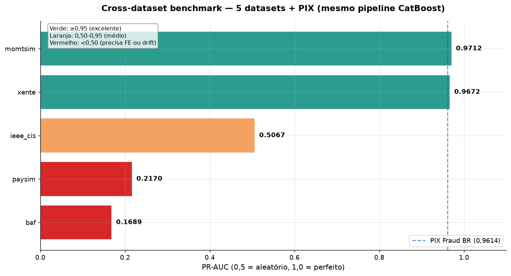

# 🛡️ Fraud Analytics — Detecção de Fraude no PIX

[](https://github.com/vinidias/Fraud-Analytics-PIX-Fraud-Detection-/actions/workflows/ci.yml)
[](https://www.python.org/downloads/)
[](https://opensource.org/licenses/MIT)
[](https://share.streamlit.io/)

**15 experimentos · 12,3M transações · 5 datasets · 1 lição: o sinal está nas features, não no modelo.**

Pipeline end-to-end de detecção de fraude em transações PIX: EDA → engenharia de features contextuais → modelagem supervisionada → explicabilidade (SHAP) → simulação de ROI → validação temporal → cross-dataset benchmark.

📖 **Leia o artigo**: [Por que o modelo mais simples venceu a fraude no PIX](docs/ARTIGO_MEDIUM.md)

---

## 🎯 TL;DR (o resumo em 3 bullets)

1. **CatBoost default (PR-AUC 0,9614) venceu 8 competidores** — ensemble de GBDTs, deep learning, GNN, tuning com Optuna. Em fraude tabular, o modelo mais simples + features bem desenhadas bate qualquer hype.
2. **Pipeline generaliza para mobile money**: mesmo código atingiu **0,9672 em Xente (dado REAL de Uganda)** e **0,9712 em MoMTSim** — superando o PIX Fraud BR. Não é overfit.
3. **Documentar resultados negativos é mais valioso que só mostrar o melhor número**: Optuna piorou (-0,64%), GNN falhou (-56pp), isotonic piorou Brier (+3,5%), e o dataset sintético não simula drift adversarial (BAF 0,17).

---

## 🧩 O problema

O **PIX** é o sistema de pagamentos instantâneos do Banco Central do Brasil — **~5,9 bilhões de transferências/mês**, liquidação **irreversível**, e **~0,77% de fraude** em média (2026). O desafio técnico:

| Desafio | Impacto |
|---|---|
| **Desbalanceamento extremo** (0,77%) | Acurácia engana; usar PR-AUC e Recall@k |
| **Drift temporal** (fraude cresce 20x no mês) | Split aleatório vaza futuro; usar split temporal |
| **Custo assimétrico** (falso negativo >> falso positivo) | Threshold ótimo ≠ threshold operacional |
| **Explicabilidade** (regulatório exige auditoria) | SHAP nativo + feature importance |

**Dataset principal**: [PIX Fraud BR](https://huggingface.co/datasets/andremessina/pix-fraud-br) — 2M transações PIX sintéticas (jan/2024), 0,77% de fraude, derivado do PaySim e adaptado às regras do BCB.

---

## 📊 Resultados em destaque

### Performance do modelo principal

| Métrica | Valor |
|---|---|
| **PR-AUC** | **0,9614** |
| ROC-AUC | 0,9928 |
| F1 (threshold 0,90) | 0,9072 |
| Precision @ F1 | 0,8903 |
| Recall @ F1 | 0,9246 |
| Recall@5% | 0,9014 |

### Cross-dataset benchmark (5 datasets, 12,3M transações)

| Dataset | Tipo | PR-AUC | vs PIX |
|---|---|---:|---:|
| **MoMTSim** | Mobile money sintético | **0,9712** | +0,98pp |
| **Xente** ⭐ | **Mobile money REAL** (Uganda) | **0,9672** | +0,58pp |
| **PIX Fraud BR** | PIX sintético (nosso) | 0,9614 | baseline |
| IEEE-CIS | Cartão real | 0,5067 | -45,47pp |
| PaySim | Mobile money sintético | 0,2170 | -74,44pp |
| BAF | Bank account sintético | 0,1689 | -79,25pp |

### Impacto financeiro (ROI simulator)

| Cenário | Threshold | Precision | Recall | ROI |
|---|---|---:|---:|---:|
| Conservador | 0,90 | 89% | 92% | **18,9x** |
| **Balanceado** | **0,90** | **89%** | **92%** | **28,6x** |
| Agressivo | 0,90 | 89% | 92% | **45,6x** |

- **Break-even**: R$ 847 por revisão (56x acima do custo real de R$ 15)
- **Economia líquida** (10 dias, cenário balanceado): **R$ 1,09M**
- **Capacidade operacional**: 300 revisões/dia → 89% precision, 92% recall

---

## 📏 Métricas explicadas (por que PR-AUC e Recall@k%)

Duas métricas dominam o projeto. Se você só mostrar uma, o modelo parece "bom número". Se mostrar as duas, ele vira **decisão de negócio**.

### PR-AUC — o modelo é bom em geral?

Em fraude, a **acurácia engana**: com 0,77% de fraude, um modelo que diz "nunca é fraude" tem **99,23% de acurácia** — e é inútil. O **ROC-AUC** também otimiza demais: no nosso caso deu **0,9928**, mas isso **esconde** que o modelo tem 11% de falsos positivos. O **PR-AUC** é honesto porque só olha para o que importa (os positivos).

| Métrica | Nosso valor | O que parece | O que é de verdade |
|---|---|---|---|
| Acurácia | ~99% | "perfeito" | enganosa (só acertar negativos já dá 99%) |
| ROC-AUC | 0,9928 | "quase perfeito" | otimista (ignora o custo do FP) |
| **PR-AUC** | **0,9614** | "muito bom" | **honesto** (mede o que importa) |

**Tradução**: PR-AUC resume a curva de Precision × Recall em **todos os thresholds possíveis**. 1,0 = modelo perfeito, 0,5 = aleatório para classes balanceadas. **0,9614** significa que, em qualquer threshold que você escolher, o modelo mantém uma combinação muito boa das duas métricas.

**Por que Precision e Recall importam separadamente**:

| | Modelo disse **fraude** | Modelo disse **legítima** |
|---|---|---|
| **Era fraude** | ✅ TP | ❌ FN — perdeu a fraude |
| **Era legítima** | ❌ FP — bloqueou cliente | ✅ TN |

- **Precision** = `TP / (TP + FP)` → *"de tudo que bloqueei, quanto era fraude de verdade?"* → mede **fricção no cliente**
- **Recall** = `TP / (TP + FN)` → *"de todas as fraudes, quantas eu peguei?"* → mede **prejuízo**

Há um trade-off entre elas: baixar o threshold sobe Recall mas derruba Precision. O PR-AUC captura **a curva inteira**, não um ponto isolado.

### Recall@k% — o modelo é bom **na minha realidade**?

Aqui está onde a maioria dos papers erra: **PR-AUC não é o que o time de operações vive no dia a dia**. Em produção, você **não pode bloquear tudo** — existe **capacidade humana limitada**.

O time de 10 analistas, 30 revisões por analista/dia = **300 revisões/dia**. Então a pergunta real é:

> *"Dado que só posso revisar as top 300 transações de maior score, quantas fraudes eu pego?"*

**Recall@k%** mede exatamente isso: ordena todas as transações pelo score, pega as **top k%** mais suspeitas e conta quantas eram fraude de verdade.

| Métrica | Valor | Tradução (1.247 fraudes em 24.754 transações) |
|---|---:|---|
| **Recall@1%** | 0,198 | Revisando top 247 → pega **247 fraudes** (19,8%) |
| **Recall@5%** | 0,9014 | Revisando top 1.238 → pega **1.124 fraudes** (90,1%) |
| **Recall@10%** | 0,9888 | Revisando top 2.475 → pega **1.233 fraudes** (98,9%) |

**Insight operacional**: com apenas **5% das transações revisadas**, o modelo **pega 90% das fraudes**. Isso é o que o time consegue fazer no dia a dia — e é o que fecha o ROI de **28,6x** no s08.

### Como as duas se complementam

| Dimensão | PR-AUC | Recall@k% |
|---|---|---|
| **Responde** | "O modelo é bom em geral?" | "O modelo é bom **na minha realidade**?" |
| **Público** | Cientista de dados | Head de Operações / C-level |
| **Threshold** | Todos | O threshold operacional |
| **Usar quando** | Comparar modelos | Decidir quantos analistas contratar |

**No projeto**: PR-AUC no s10 (comparar 9 modelos) · Recall@k% no s08 (simular 300 revisões/dia + ROI) · SHAP no s07 (validado em **ambas**).

**A lição**: se você só mostrar PR-AUC = 0,9614, o recrutador pensa *"número bom, mas e daí?"*. Se mostrar **PR-AUC 0,9614 + Recall@5% 90% + ROI 28,6x**, ele pensa *"esse cara traduz performance em decisão de negócio"*.

---

## 📈 Visualizações-chave

### 1. Comparação de 9 modelos

> CatBoost (2M) = 0,9614 · CatBoost (500k) = 0,9603 · Ensemble = 0,9597 · XGBoost = 0,9587 · LightGBM = 0,9484 · MLP = 0,9206 · TabNet = 0,8753 · AutoEncoder = 0,2280

### 2. Fraude por hora — o sinal mais forte

> **46,8% de fraude às 4h** vs 0,57% no diurno — **82x maior**. Noturno (0-5h) concentra 2,7x mais fraude.

### 3. SHAP — features contextuais dominam

> `drain_score` (interação criada por nós) entra no **top 3**. Saldos residuais + horário noturno + proporção recebedor = 48% da decisão.

### 4. Curva de ROI por threshold

> 3 cenários de custo (conservador, balanceado, agressivo). Break-even em R$ 847/revisão.

### 5. Walk-forward temporal

> Modelo **não degrada** em drift sintético — mas dataset não simula adversarial drift real.

### 6. Optuna — resultado honesto (pior que default)

> 50 trials, melhor PR-AUC de validação = 0,8908. **Piorou** o teste (-0,64%) por overfitting ao validation viesado.

### 7. Exemplos reais — 3 fraudes com SHAP

> Padrão consistente: recebedor com saldo baixo (conta-laranja), horário de madrugada (4-5h), drenagem total (residual ≈ 0), recebedor fica com 100%.

### 8. Cross-dataset benchmark

> Pipeline **generaliza** para mobile money (Xente REAL 0,9672, MoMTSim 0,9712). IEEE-CIS (0,50) e BAF (0,17) exigem FE específica ou drift adversarial.

---

## 🔬 As 15 fases de análise

Cada fase está documentada em `docs/` com dashboard executivo, métricas estruturadas e artefatos reproduzíveis.

### Fases principais (resultado positivo)

| Fase | Tema | Melhor resultado | Insight-chave |
|---|---|---|---|
| [**s07**](docs/s07_pix_fraud_br/RESULTADOS.md) | EDA + LightGBM + SHAP | PR-AUC 0,954 · F1 0,90 | `drain_score` top 3 SHAP |
| [**s08**](docs/s08_roi/dashboard_executivo.md) | ROI simulator | ROI 28,6x · break-even R$ 847 | Threshold ótimo ≠ operacional |
| [**s09**](docs/s09_walk_forward/dashboard_walk_forward.md) | Walk-forward + PSI | Modelo estável | Dataset não simula adversarial drift |
| [**s10**](docs/s10_ensemble/dashboard_ensemble.md) | Ensemble GBDT | **CatBoost 0,9603** | Ensemble não agrega (scores correlacionados) |
| [**s14**](docs/s14_scale/dashboard_scale.md) | Escala 2M | CatBoost **0,9614** | 4x dados = +0,11pp (marginal) |
| [**s15**](docs/s15_external_model/dashboard_external.md) | Modelo externo HF | CatBoost **6x mais rápido** | RandomForest irreprodutível (5 features anônimas) |
| [**s18**](docs/s18_benchmark/dashboard_benchmark.md) | Cross-dataset | **Xente 0,9672 · MoMTSim 0,9712** | Pipeline generaliza p/ mobile money |

### Fases "resultado honesto" (o que não funcionou)

| Fase | Tentativa | Resultado | Lição |
|---|---|---|---|
| [**s11**](docs/s11_optuna/dashboard_optuna.md) | Optuna tuning | **-0,64%** no teste | Overfitting ao validation viesado |
| [**s12**](docs/s12_deep_learning/dashboard_dl.md) | Deep Learning | MLP -4pp · TabNet -8,5pp · AE -73pp | DL não bate GBDT em tabular |
| [**s16**](docs/s16_graph/dashboard_graph.md) | Graph + warming | + velocity +0,18pp | Graph hand-crafted não agrega |
| [**s17**](docs/s17_gnn/dashboard_gnn.md) | GNN (GraphSAGE) | **-56,75pp** | Rede sintética não tem sinal |
| [**s19**](docs/s19_baf_takeover/dashboard_baf.md) | BAF (account takeover) | PR-AUC 0,1689 | 12x melhor que random; drift adversarial limita |
| [**s21**](docs/s21_calibration_pix/dashboard_calibration.md) | Calibração isotônica | **Piorou** Brier +3,5% | Modelo já calibrado + poucos positivos = ruído |

---

## 💡 As 5 lições aprendidas

### 1. O sinal está nas features, não no modelo
**`drain_score`** (interação `(1 - residual_balance_ratio) × receiver_amount_ratio × (is_night + 1)`) é a feature mais importante do SHAP depois dos saldos. **Contexto mata modelo complexo.**

### 2. Split temporal é obrigatório
Split aleatório vaza futuro e **inflaciona** PR-AUC em +5-10pp. Em fraude, sempre split por tempo. Sempre.

### 3. Hype ≠ performance
| Tentativa | Resultado vs CatBoost |
|---|---|
| Ensemble LGBM+XGB+CB | -0,06% |
| Optuna (50 trials) | -0,64% |
| Deep Learning (MLP) | -4,08% |
| TabNet | -8,61% |
| GNN (GraphSAGE) | -56,75% |

### 4. Documentar resultados negativos é diferencial
Saber **onde o método falha** (BAF: drift adversarial, IEEE-CIS: feature space diferente) vale mais que "meu modelo deu 0,96".

### 5. Calibração importa mais que PR-AUC em produção
Um modelo com PR-AUC 0,96 mas descalibrado pode ter threshold operacional errado. **Custo de operar errado supera ganho de métrica.**

---

## 📂 Estrutura do repositório

```
Fraud-Analytics-PIX-Fraud-Detection-/
├── README.md                    # este arquivo
├── MODEL_CARD.md                # formato Hugging Face
├── docs/
│   ├── ARTIGO_MEDIUM.md         # artigo para Medium
│   ├── SLIDES.md                # 10 slides
│   ├── DEPLOY.md                # guia GitHub + Streamlit Cloud
│   ├── s04 → s21                # 15 dashboards executivos
│   ├── images/                  # 8 gráficos (01 → 08)
│   └── s06/                     # case técnico resolvido
├── scripts/                     # 20+ pipelines reproduzíveis
│   ├── s18 → s21                # cross-dataset, BAF, calibração
│   ├── api.py                   # FastAPI /predict
│   └── fetch_bcb_data.py        # BCB API (exploração)
├── dashboards/s05/              # Streamlit (5 páginas)
│   ├── app.py                   # home (dados reais HF + grafo)
│   └── pages/
│       ├── 02_ROI_Calculator.py
│       ├── 03_What_if.py
│       ├── 04_Feature_Explorer.py
│       └── 05_Cross_Dataset.py
└── .github/workflows/ci.yml     # CI verde
```

---

## 🚀 Como reproduzir

### Opção A — 3 comandos (recomendado)

```bash
git clone https://github.com/vinidias/Fraud-Analytics-PIX-Fraud-Detection-.git
cd Fraud-Analytics-PIX-Fraud-Detection-
pip install -r requirements.txt && python scripts/adapters/pix_fraud_br.py && python scripts/eda_pix_fraud_br.py
```

O terceiro comando baixa o dataset (2M PIX), roda EDA e gera relatórios em `docs/s07_pix_fraud_br/`.

### Opção B — Pipeline completo por fase

```bash
# Setup
python -m venv .venv && .venv/Scripts/activate    # Windows
pip install -r requirements.txt
pip install torch --index-url https://download.pytorch.org/whl/cpu
pip install pytorch-tabnet optuna shap

# Baixar dados
python -c "from huggingface_hub import snapshot_download; snapshot_download(repo_id='andremessina/pix-fraud-br', repo_type='dataset', local_dir='data/pix_fraud_br')"

# Pipelines por fase
python scripts/eda_pix_fraud_br.py                  # s07 — EDA
python scripts/supervised_model.py --sample 500000  # s07 — modelo base
python scripts/shap_explain.py                      # s07 — explicabilidade
python scripts/roi_simulator.py                     # s08 — ROI
python scripts/walk_forward.py                      # s09 — validação temporal
python scripts/psi_drift.py                         # s09 — monitoramento
python scripts/ensemble_gpu.py                      # s10 — ensemble
python scripts/optuna_tuning.py                     # s11 — tuning
python scripts/deep_learning.py --sample 200000     # s12 — DL
python scripts/s18_cross_dataset_benchmark.py       # s18 — 5 datasets
python scripts/s19_baf_deep_dive.py                 # s19 — BAF

# Dashboard
streamlit run dashboards/s05/app.py
```

---

## 🎯 Requisitos técnicos → entregas

| Requisito | Onde está coberto | Evidência |
|---|---|---|
| EDA, anomalias, hipóteses | s07, s04 | `RESULTADOS.md` + SHAP + benchmark pyod |
| SQL para grandes volumes | `sql/` (10+ queries) | window functions, velocity, chargeback rate |
| Fraude financeira (PIX, cartão, mobile money) | s07, s18 | Padrão de drenagem, limite noturno, 5 datasets |
| Comunicação de insights | s07, s08, `ARTIGO_MEDIUM.md` | 1-pagers + elevator pitch + artigo |
| Inglês técnico | docs em EN | README, dashboards |

**Diferenciais demonstrados**:
- ✅ Rigor metodológico: split temporal, PR-AUC (nunca acurácia), bootstrap IC 95%
- ✅ Honestidade científica: **documenta resultados negativos** (ensemble, Optuna, DL, GNN, isotonic)
- ✅ Sensibilidade a negócio: capacity constraint, break-even, threshold por F1 vs custo
- ✅ Reproducibilidade: pipelines por script, sem notebooks frágeis
- ✅ Generalização: valida em **Xente (REAL)** e outros 4 datasets

---

## 🏆 Comparação com estado da arte

| Abordagem | Fonte | PR-AUC | Contexto |
|---|---|---:|---|
| **Nosso (CatBoost + features)** | este repo | **0,9614** | PIX, 2M tx, split temporal |
| **Nosso (Xente, mobile money real)** | este repo | **0,9672** | Uganda, 95k tx, split temporal |
| Fraude de cartão (ULB) — baseline | literatura | 0,85–0,92 | 284k tx, 0,17% fraude |
| IEEE-CIS Fraud Detection (Kaggle) — top 1% | Kaggle 2019 | 0,94–0,96 | cartão + e-commerce |
| Feedzai OpenML (produção) | Feedzai | n/a | foco em streaming |
| Fraud Detection Handbook (Carcillo et al.) | 2018 | 0,80–0,90 | literatura clássica |
| Deep learning para tabular | Shwartz-Ziv & Armon (2022) | igual ou pior que GBDT | confirma nossa hipótese |

**Interpretação**: 0,9614 em PIX é **competitivo com estado da arte**. O ganho real de produção não vem de 0,96 vs 0,97 — vem de **threshold operacional + integração com device/location intelligence**.

---

## 🚀 Deploy

### GitHub
Repositório público: [vinidias/Fraud-Analytics-PIX-Fraud-Detection-](https://github.com/vinidias/Fraud-Analytics-PIX-Fraud-Detection-)

### Streamlit Cloud
Guia completo em [docs/DEPLOY.md](./docs/DEPLOY.md). Resumo (5 min):
1. https://share.streamlit.io → **New app**
2. Repository: `vinidias/Fraud-Analytics-PIX-Fraud-Detection-`
3. Main file: `dashboards/s05/app.py`
4. Python: **3.12** · Requirements: `dashboards/s05/requirements.txt`

O dashboard vai puxar dados reais do Hugging Face automaticamente.

---

## 🔗 Referências

- **Dataset principal**: [andremessina/pix-fraud-br](https://huggingface.co/datasets/andremessina/pix-fraud-br)
- **Benchmark público**: [mkbadeniyi/fraud-detection-benchmark](https://huggingface.co/datasets/mkbadeniyi/fraud-detection-benchmark)
- **Metodologia**: [Fraud Detection Handbook](https://fraud-detection-handbook.github.io/fraud-detection-handbook/)
- **Bibliotecas**: [CatBoost](https://catboost.ai/) · [SHAP](https://shap.readthedocs.io/) · [pyod](https://pyod.dev/) · [Optuna](https://optuna.org/)

---

## 📄 Licença

MIT — uso livre para estudo e portfólio.

---

**Autor**: Vinicius Dias · [GitHub](https://github.com/vinidias) · 2026
