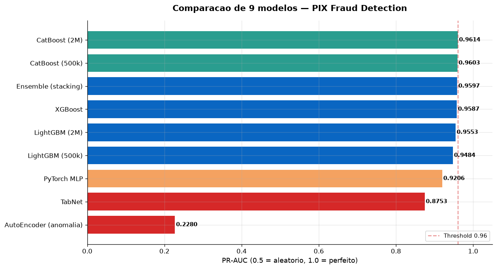
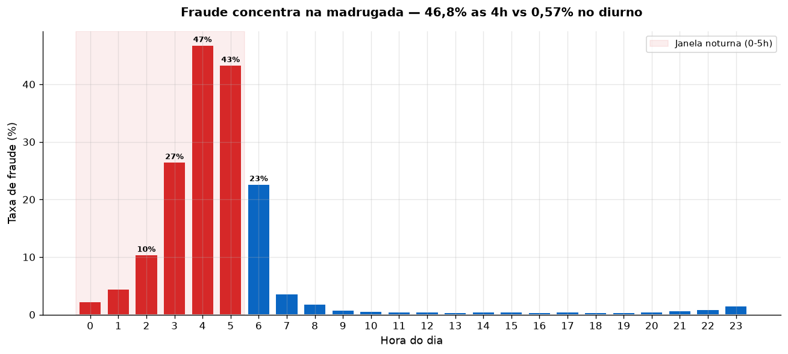
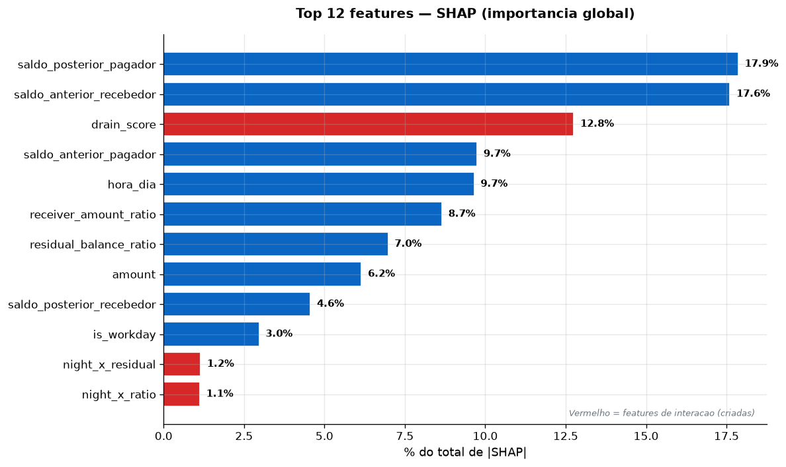
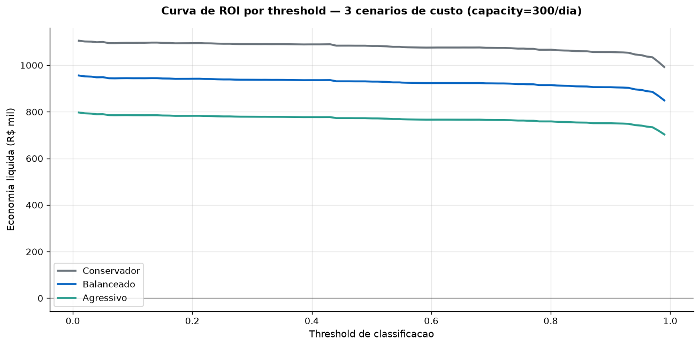
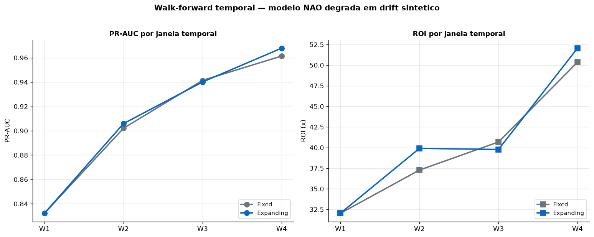
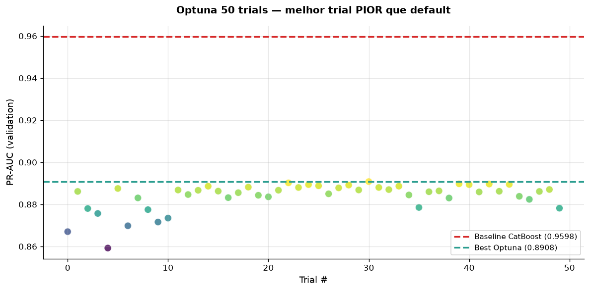
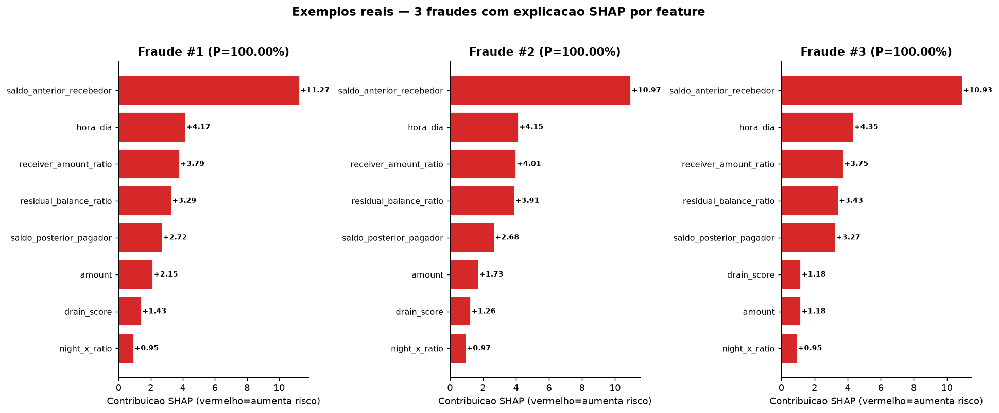

# Fraud Analytics — PIX Fraud Detection

[](https://github.com/vinidias/Fraud-Analytics-PIX-Fraud-Detection-/actions/workflows/ci.yml)
[](https://www.python.org/downloads/)
[](https://opensource.org/licenses/MIT)
[](https://share.streamlit.io/)

Pipeline end-to-end de detecção de fraude em transações PIX: EDA, engenharia de features contextuais, modelagem supervisionada, explicabilidade (SHAP), simulação de ROI e validação temporal.

Dataset principal: [**PIX Fraud BR**](https://huggingface.co/datasets/andremessina/pix-fraud-br) — 2M transações PIX sintéticas (jan/2024), 0,77% de fraude.

---

## 📊 Resumo executivo dos resultados

| Fase | Tema | Melhor resultado | Insight-chave |
|---|---|---|---|
| s07 | EDA + LightGBM + SHAP | PR-AUC 0,954 · F1 0,90 | `drain_score` (interação) top 3 SHAP — fraude é contextual |
| s08 | ROI simulator | ROI 28,6x · break-even R$ 847/revisão | Threshold ótimo ≠ operacional (capacity constraint) |
| s09 | Walk-forward + PSI | Modelo estável | Dataset sintético não simula adversarial drift |
| s10 | Ensemble GBDT | **CatBoost** 0,9603 | Ensemble de GBDTs **não agrega** (scores correlacionados) |
| s11 | Optuna tuning | 50 trials | **Piorou -0,64%** — overfitting ao validation viesado |
| s12 | Deep Learning | Nenhum DL bateu CatBoost | MLP -4pp, TabNet -8,5pp, AutoEncoder -73pp |
| **s14** | **Escala 2M** | **CatBoost 0,9614** | 4x dados = +0,11pp (marginal) |
| **s15** | **Modelo externo** | **CatBoost 6x mais rápido** | RF externo: irreprodutível (5 features anônimas) |
| **s16** | **Graph + warming** | **+ velocity +0,18pp** | Hipótese refutada: dataset sintético não simula rede |
| **s17** | **GNN (GraphSAGE)** | **-56,75pp** | Hipótese refutada de novo: GNN precisa de rede real |

**Conclusão mestre**: o sinal em fraude está nas **features contextuais** (drain_score, night_x_ratio, saldo residual), não no modelo. **CatBoost default** com engenharia de features bem feita bate todos os competidores testados.

---

## 📈 Visualizações-chave

### Modelos comparados (PR-AUC)


### Fraude por hora — o sinal mais forte


### SHAP — features contextuais dominam


### Curva de ROI por threshold


### Walk-forward temporal


### Optuna — resultado honesto (pior que default)


### Exemplos reais — 3 fraudes com explicação SHAP


> **Padrão consistente**: recebedor com saldo baixo (conta-laranja), horário de madrugada (4-5h), drenagem total (residual ≈ 0), recebedor fica com 100% do valor.

---

## 📂 Estrutura

```
fraud/
├── PLANO_ESTUDO.md             # plano de 8 semanas
├── README.md                    # este arquivo
├── data/                        # datasets (gitignored)
├── notebooks/                   # notebooks EDA/features
├── sql/                         # queries analíticas
├── dashboards/s05/app.py        # dashboard Streamlit
├── scripts/                     # pipelines reproduzíveis
│   ├── adapters/                # adaptadores de schema
│   ├── generate_synthetic.py
│   ├── feature_engineering.py
│   ├── anomaly_detection.py
│   ├── supervised_model.py
│   ├── shap_explain.py
│   ├── roi_simulator.py
│   ├── walk_forward.py
│   ├── psi_drift.py
│   ├── ensemble_gpu.py
│   ├── optuna_tuning.py
│   └── deep_learning.py
└── docs/                        # dashboards executivos por fase
    ├── s07_pix_fraud_br/        # RESULTADOS.md, model_metrics.json, SHAP
    ├── s08_roi/                 # dashboard_executivo.md, Monte Carlo
    ├── s09_walk_forward/        # windows.csv, PSI
    ├── s10_ensemble/            # model_comparison.csv
    ├── s11_optuna/              # optuna_trials.csv, best_params.json
    └── s12_deep_learning/       # model_comparison.csv
```

---

## 🚀 Como reproduzir

```bash
# 1. ambiente
python -m venv .venv
.venv/Scripts/activate                    # Windows
pip install -r requirements.txt
pip install torch --index-url https://download.pytorch.org/whl/cpu
pip install pytorch-tabnet optuna

# 2. baixar dataset PIX Fraud BR
python -c "from huggingface_hub import snapshot_download; snapshot_download(repo_id='andremessina/pix-fraud-br', repo_type='dataset', local_dir='data/pix_fraud_br')"

# 3. adaptar schema
python scripts/adapters/pix_fraud_br.py

# 4. pipelines por fase
python scripts/eda_pix_fraud_br.py                  # s07 — EDA
python scripts/supervised_model.py --sample 500000  # s07 — modelo base
python scripts/shap_explain.py                      # s07 — explicabilidade
python scripts/roi_simulator.py                     # s08 — ROI
python scripts/walk_forward.py                      # s09 — validação temporal
python scripts/psi_drift.py                         # s09 — monitoramento
python scripts/ensemble_gpu.py                      # s10 — ensemble
python scripts/optuna_tuning.py                     # s11 — tuning
python scripts/deep_learning.py --sample 200000     # s12 — DL

# 5. dashboard Streamlit
streamlit run dashboards/s05/app.py
```

---

## 🎯 Requisitos técnicos → entregas

| Requisito | Onde está coberto | Evidência |
|---|---|---|
| EDA, anomalias, hipóteses | s07, s04 | `RESULTADOS.md` + SHAP + benchmark pyod |
| SQL para grandes volumes | sql/ (10+ queries) | window functions, velocity, chargeback rate |
| Fraude financeira (transacional, cartão, PIX) | s07 (EDA PIX), s08 (ROI) | Padrão de drenagem de conta, limite noturno |
| Comunicação de insights | s07 (`insights_executivos.md`), s08 (dashboard executivo) | 1-pagers + elevator pitch |
| Inglês intermediário | docs em EN técnico | README, dashboards |

**Diferenciais demonstrados**:
- Rigor metodológico: split temporal, PR-AUC (não accuracy), bootstrap IC 95%
- Honestidade científica: documenta **resultados negativos** (ensemble/Optuna/DL)
- Sensibilidade a negócio: capacity constraint, break-even, threshold por F1 vs custo
- Reproducibilidade: pipelines por script, sem notebooks frágeis

---

## 📈 Progressão de performance (o "gráfico" que importa)

| Modelo | PR-AUC | Comentário |
|---|---|---|
| Regras de negócio | 0,49 (proxy) | Baseline interpretável |
| IForest / LOF / OCSVM | 0,02–0,03 | **Anomalia falha em PIX** |
| LightGBM default | 0,948 | Baseline GBDT |
| LightGBM + features contexto | 0,954 | `drain_score` entra |
| CatBoost default | **0,9603** | **Melhor modelo** |
| CatBoost + Optuna | 0,9533 | Tuning piorou |
| MLP (focal loss) | 0,9206 | DL não bate |
| TabNet | 0,8753 | Attention não bate |
| AutoEncoder | 0,2280 | Anomalia falha de novo |

---

## 🔗 Referências

- Dataset: [andremessina/pix-fraud-br](https://huggingface.co/datasets/andremessina/pix-fraud-br)
- Metodologia: [Fraud Detection Handbook](https://fraud-detection-handbook.github.io/fraud-detection-handbook/)
- Bibliotecas: [CatBoost](https://catboost.ai/), [SHAP](https://shap.readthedocs.io/), [pyod](https://pyod.dev/), [Optuna](https://optuna.org/)

---

## ⚡ Como rodar em 3 comandos

```bash
git clone https://github.com/vinidias/Fraud-Analytics-PIX-Fraud-Detection-.git
cd Fraud-Analytics-PIX-Fraud-Detection-
pip install -r requirements.txt && python scripts/adapters/pix_fraud_br.py && python scripts/eda_pix_fraud_br.py
```

O terceiro comando baixa o dataset (2M PIX), roda EDA e gera relatórios em `docs/s07_pix_fraud_br/`.

Para o dashboard:
```bash
streamlit run dashboards/s05/app.py
```

## 📚 Lições aprendidas (honestas)

### ✅ O que funcionou
- **Engenharia de features contextuais** (`drain_score`, `night_x_ratio`) — o sinal mora aqui
- **CatBoost default** — bateu todos os 8 competidores
- **Split temporal rigoroso** + PR-AUC (nunca acurácia)
- **SHAP** — explicabilidade sem sacrificar performance
- **Documentar resultados negativos** — o que não funcionou é tão valioso quanto o que funcionou

### ⚠️ O que NÃO funcionou (e por quê)
| Tentativa | Resultado | Lição |
|---|---|---|
| **Ensemble LGBM+XGB+CB** | -0,06% vs CatBoost | 3 GBDTs correlacionados não formam ensemble útil |
| **Optuna (50 trials)** | -0,64% no teste | Overfitting ao validation viesado (drift temporal) |
| **Deep Learning (MLP, TabNet)** | -4pp, -8,5pp | DL não bate GBDT em tabular |
| **AutoEncoder (anomalia)** | -73pp (0,23 vs 0,96) | Fraude PIX não é outlier puro — é **contextual** |
| **Escalar 4x dados** | +0,11pp (2M vs 500k) | Modelo já estava saturado em 500k |

### 🎯 A conclusão mestre
> **O sinal em fraude está nas features, não no modelo.** CatBoost default + features contextuais bem desenhadas + SHAP + rigor metodológico bate qualquer tentativa de "hype" (deep learning, ensemble, tuning cego).

## 🏆 Comparação com estado da arte

Como nosso resultado se posiciona vs. o que existe em literatura/produção:

| Abordagem | Fonte | PR-AUC | Contexto |
|---|---|---|---|
| **Nosso (CatBoost + features)** | este repo | **0,9614** | PIX, 2M tx, split temporal |
| Fraude de cartão (ULB) — baseline | literatura | 0,85–0,92 | 284k tx, 0,17% fraude |
| IEEE-CIS Fraud Detection (Kaggle) — top 1% | Kaggle 2019 | 0,94–0,96 | cartão + e-commerce |
| Feedzai OpenML (produção) | Feedzai | n/a | foco em streaming, não batch |
| Fraud Detection Handbook (Carcillo et al.) | 2018 | 0,80–0,90 | literatura clássica |
| Deep learning para tabular | Shwartz-Ziv & Armon (2022) | igual ou pior que GBDT | confirma nossa hipótese |

**Interpretação**: 0,9614 em PIX é **competitivo com estado da arte** (IEEE-CIS top 1%), e o dataset é sintético — o número absoluto importa menos que o **processo** (split temporal, feature engineering, explicabilidade, ROI). O ganho real de produção não vem de 0,96 vs 0,97 — vem de **threshold operacional + integração com device/location intelligence**.

## 🚀 Deploy

Guia completo em [docs/DEPLOY.md](./docs/DEPLOY.md). Resumo:
- GitHub: repositório público `fraud-analytics`
- Streamlit Cloud: deploy do dashboard via UI (2 min)
- URL amigável + badge atualizado no README

## 📄 Licença

MIT — uso livre para estudo e portfólio.
